# SafeSwap — Middleman & Escrow Platform (PWA)

A trusted middleman and escrow Progressive Web App developed for the **CS111 Startup Simulation Project** (CS111 Introduction to Computing • Section 1D • Team 4).

SafeSwap provides an auditable, fraud-resistant escrow service for peer-to-peer student transactions, digital services, electronics, and student freelancing/micro-gigs in the Philippines. It operates a secure workflow where buyer funds are collected via **Manual QR Ph**, verified by human staff, safely protected during seller delivery and inspection, and disbursed to the seller via **QR Ph / InstaPay**.

---

## 📱 Product Tour & Interface Showcase

SafeSwap is built with a mobile-first, flat, accessible design system tailored for Philippine peer-to-peer commerce. Below are live captures of the platform across desktop and mobile devices.

### 1. Escrow Dashboard
The central dashboard where users monitor active and completed escrow transactions. Displays live state badges (`HELD`, `DELIVERED`, `DISPUTED`), counterparty identities, SLA countdowns, and quick access to funding and dispute management.

| Desktop View | Mobile View |
| :---: | :---: |
| 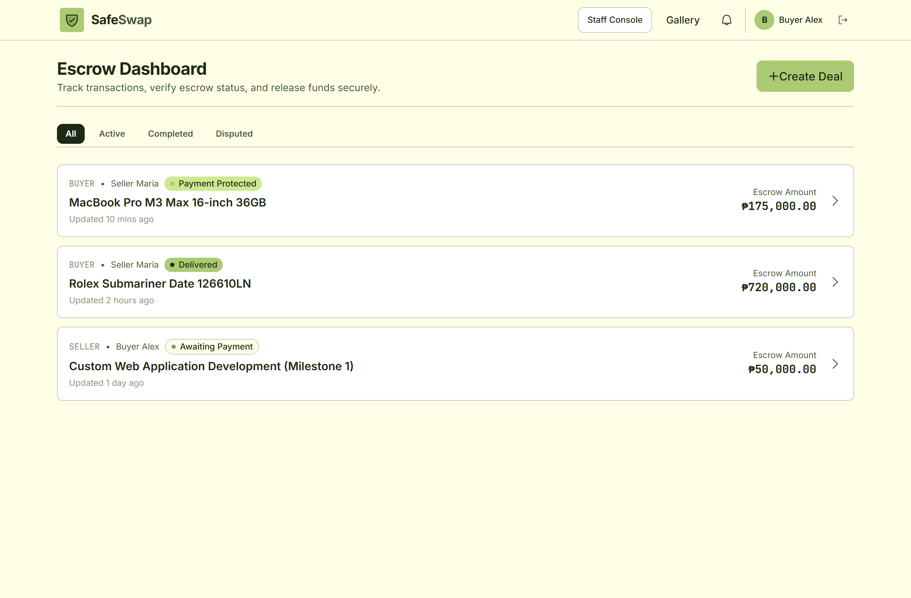 | 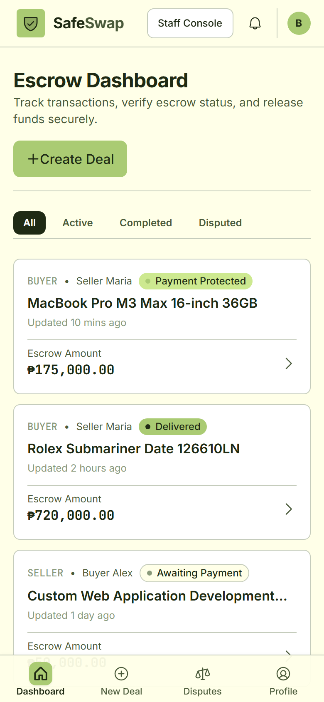 |

---

### 2. Manual QR Ph Payment & Funding
When a deal is created, the buyer receives a high-contrast national standard QR Ph code with the exact centavo amount and a unique deal reference code (`SS-XXXXXXXX`). Funds are transferred directly to SafeSwap's regulated escrow account and evidence is uploaded for human verification.

| Desktop View | Mobile View |
| :---: | :---: |
| 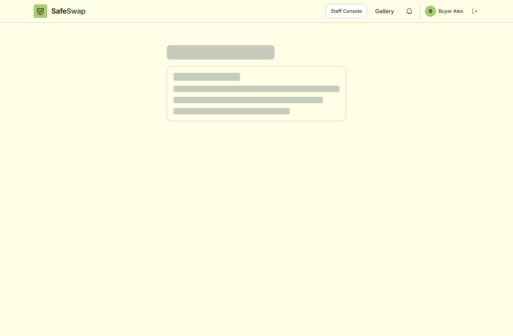 | 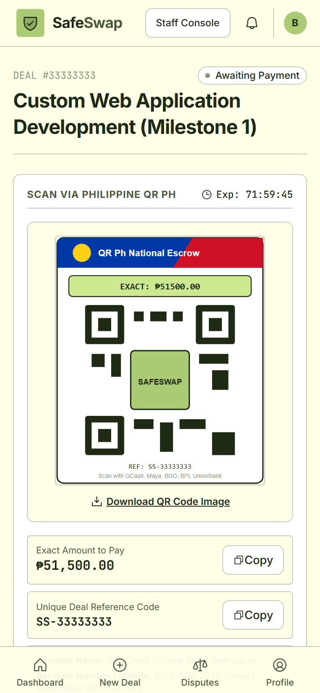 |

---

### 3. Deal Detail & AI Escrow Risk Screener
Provides an immutable audit timeline of each milestone: **Deal Created** → **Payment Verified & Funds Protected** → **Seller Delivery Proof** → **Buyer Receipt Confirmation** → **Payout Released**. Includes the built-in **AI Escrow Risk & Safety Screener** which automatically analyzes deal terms, flags off-platform scam patterns, and calculates an objective Trust Score.

| Desktop View | Mobile View |
| :---: | :---: |
| 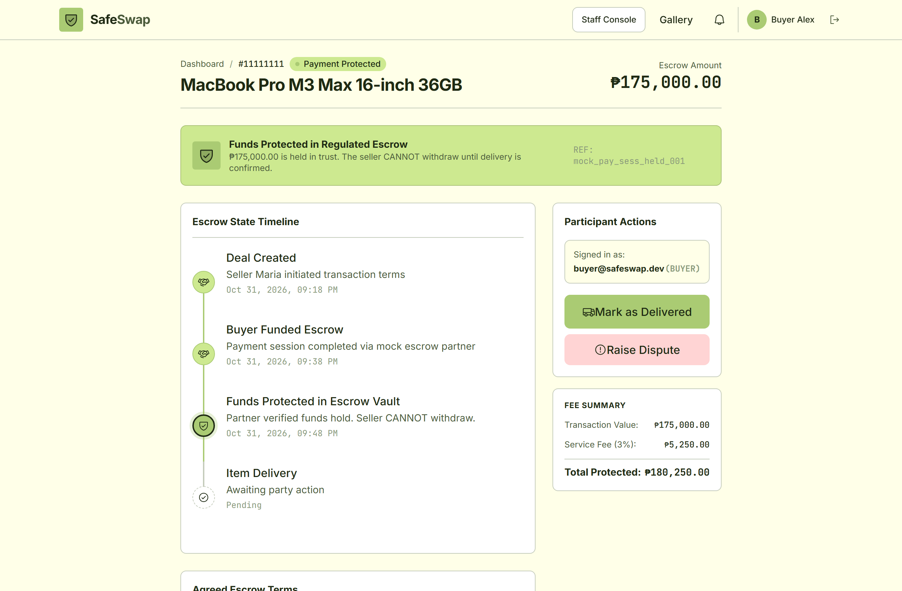 | 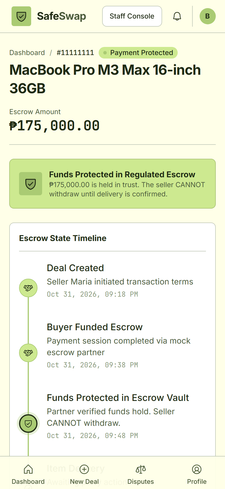 |

---

### 4. Staff Verification Console (`/staff`)
Dedicated operational interface for SafeSwap escrow officers. Allows staff to match incoming bank receipts against statements, enforce duplicate-reference fraud checks, and disburse seller payouts via InstaPay under strict **Four-Eyes** segregation.

| Desktop View | Mobile View |
| :---: | :---: |
| 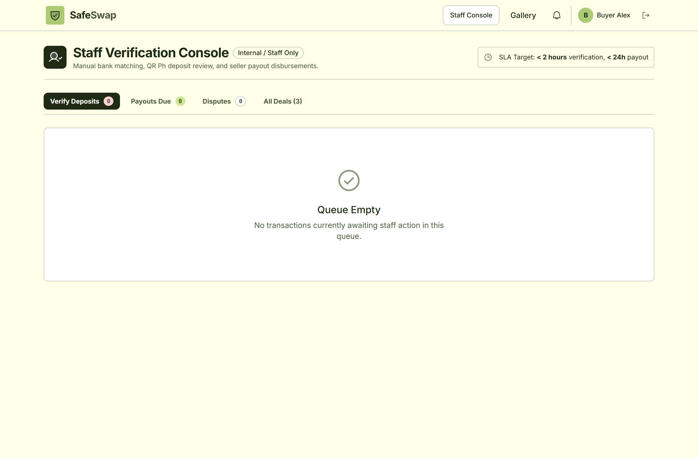 | 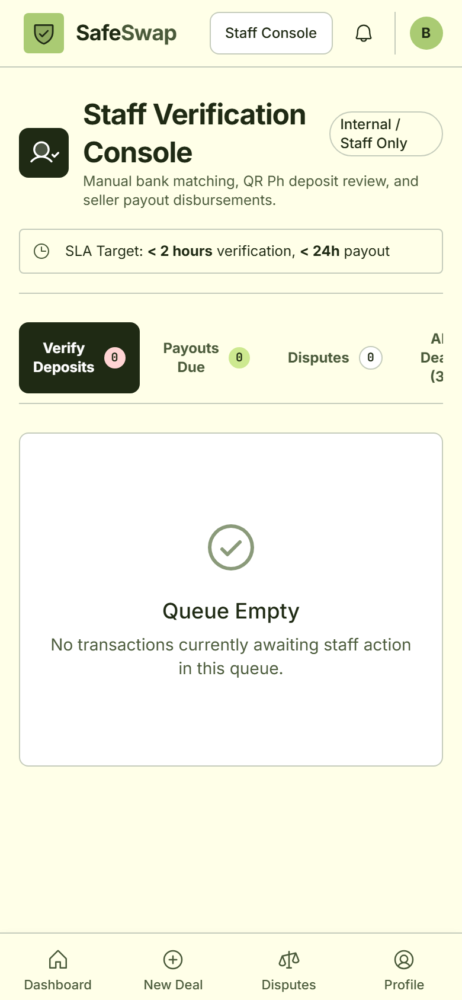 |

---

### 5. 1-Click Simulation Personas & Prototype Auth (`/auth`)
Instant role switching for prototype testing and evaluation. Allows evaluators and developers to toggle between **Buyer Alex**, **Seller Maria**, and **Staff Specialist** with a single click, completely eliminating email confirmation roadblocks.

| Desktop View | Mobile View |
| :---: | :---: |
| 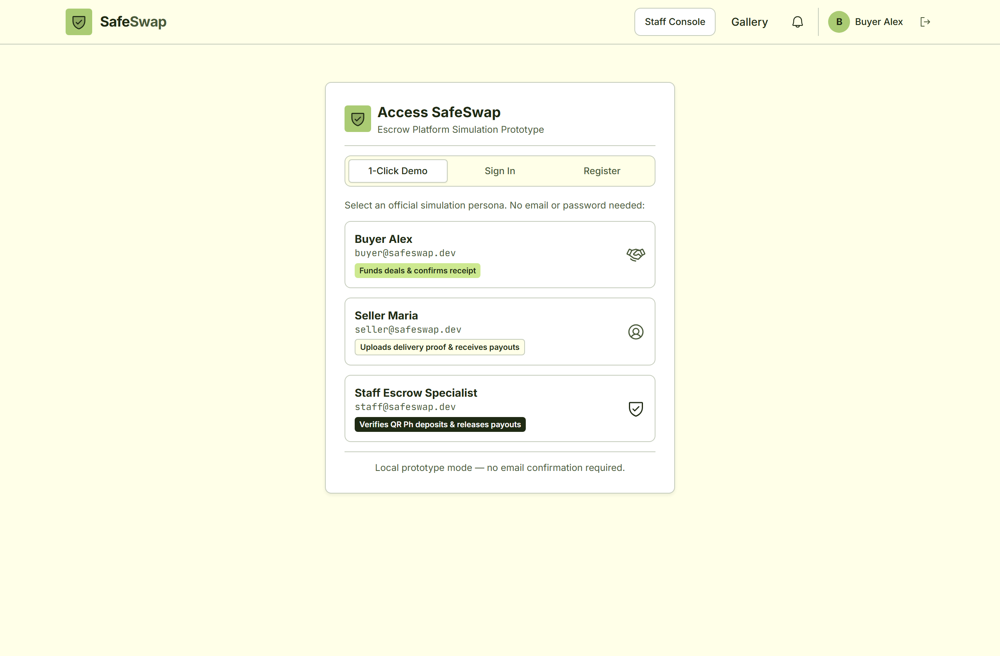 | 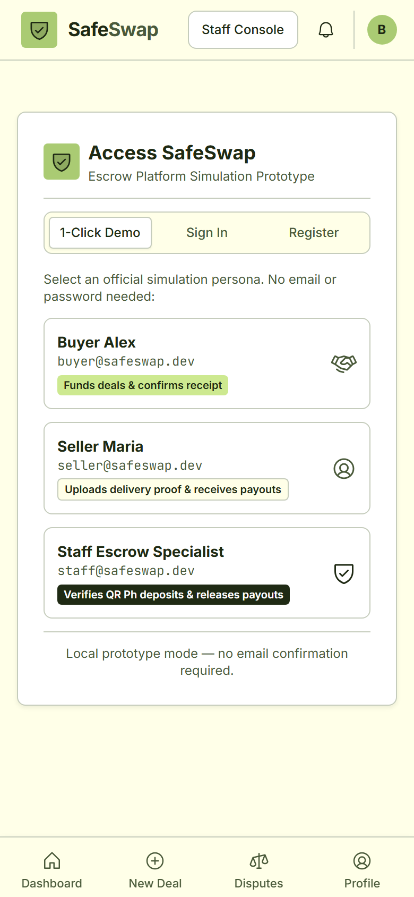 |

---

### 6. Design System & WCAG Contrast Gallery (`/gallery`)
Showcase of SafeSwap's flat design system, tokens, and comprehensive WCAG 2.1 AA color contrast compliance table (all text pairs meet $\ge$ 4.5:1 ratio).

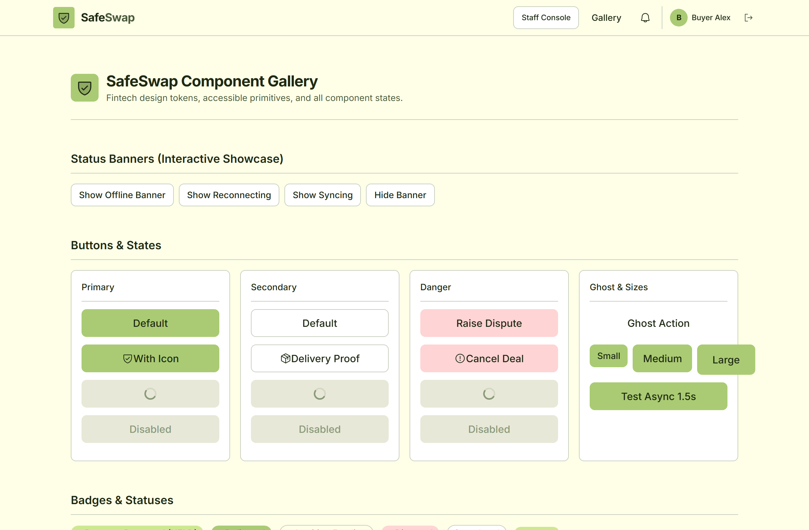

---

## 🤖 AI-Assisted Features in SafeSwap

SafeSwap integrates artificial intelligence and heuristic models to actively support safety, scam mitigation, and dispute resolution across the platform:

```
┌────────────────────────────────────────────────────────────────────────┐
│                      SafeSwap AI Assistant Engine                      │
├─────────────────────────┬──────────────────────┬───────────────────────┤
│ 1. Deal Risk Screener   │ 2. Receipt Screener  │ 3. Dispute Assistant  │
│ Scans terms for scam    │ Audits reference     │ Evaluates evidence    │
│ patterns & off-platform │ codes & detects      │ against agreed terms  │
│ triggers (0-100 Trust)  │ duplicate reuse      │ for staff resolution  │
└─────────────────────────┴──────────────────────┴───────────────────────┘
```

### 1. AI Deal Risk & Scam Screener
- **Off-Platform Pattern Detection**: Flags keywords urging users to move communication or funds outside SafeSwap (e.g., Telegram, Viber, direct GCash/Maya transfers), preserving escrow legal protection.
- **Term Clarity Scoring**: Verifies whether deals contain measurable inspection criteria, concrete timeframes (e.g., 24–48h inspection), and verifiable acceptance conditions.
- **High-Value Scrutiny**: Deals exceeding ₱50,000.00 automatically trigger enhanced courier requirements (armored/insured couriers like Air21/LBC) and unboxing video advisories.
- **Trust Score**: Outputs an actionable Trust Score (e.g., `LOW RISK • 95% TRUST`) directly on the deal overview.

### 2. AI Receipt & Reference Anomaly Checking
- **Format Validation**: Cross-checks user-entered reference codes against standard Philippine banking and e-wallet conventions (GCash 9–13 digit numeric sequences, InstaPay trace numbers).
- **Duplicate Detection**: Flags attempts to reuse previously submitted reference numbers across deals before human staff review.
- **Timestamp Plausibility**: Verifies that payment execution timestamps precede delivery and correspond with active banking business windows.

### 3. AI Dispute Resolution Recommendation Engine
- **Contract Adjudication**: When a buyer contest arises, the engine synthesizes the buyer's reason, seller's dispatch proof, and the original terms agreed at deal inception.
- **Recommended Action**: Generates an unbiased recommendation (`FULL_REFUND`, `PARTIAL_REFUND_RETURN`, `RELEASE_TO_SELLER`, or `MANUAL_MEDIATION`) with a confidence score to aid human staff during dispute arbitration.

---

## 🎨 Design System, Color Tokens & Accessibility

SafeSwap features a tactile, physical-inspired design system engineered specifically for clarity, readability in bright tropical sunlight, and institutional trust.

### Color Tokens & Palette Rationale

| Token Name | Hex Code | Visual Role | Emotional & Functional Intent |
| :--- | :---: | :--- | :--- |
| **`cream`** | `#FFFFE8` | Primary Application Surface | Soft, warm paper tone that replaces clinical, harsh `#FFFFFF` backgrounds. Reduces glare on mobile screens during outdoor meetups. |
| **`ink`** | `#1F2A14` | Primary Text & Structural Borders | Deep olive-tinted ink (never harsh pure `#000000`). Provides razor-sharp contrast while harmonizing organically with natural light. |
| **`ink-muted`** | `#4A5A3A` | Secondary Text & Subtitles | Subdued olive tone for timestamps, secondary labels, and helper hints. |
| **`ink-light`** | `#8A9A7A` | Inactive & Disabled Elements | Subtle muted shade for breadcrumb separators and disabled UI states. |
| **`green`** | `#AACB73` | Primary Action & Protection | Earthy, dependable olive-green used for primary call-to-action buttons, step completions, and verified escrow shields. |
| **`lime`** | `#CDE990` | Accent & Status Highlights | High-visibility pastel accent for monetary amounts, transaction callout boxes, and success notifications. |
| **`blush`** | `#FFD4D4` | Alert, Danger & Disputes | Gentle red-tinted pastel for payment rejection notices, cancellation alerts, and dispute warnings. |
| **`white`** | `#FFFFFF` | Card & Dialog Backgrounds | Crisp white elevated surfaces that sit comfortably atop the warmer `cream` foundation. |

### Visual Design Principles
- **No Blur Drop-Shadows**: In accordance with the flat physical design ethos, elevations are rendered using 1px–2px crisp `ink` borders rather than muddy diffuse drop-shadows.
- **Tactile Micro-Radii**: Buttons and cards use restrained micro-radii (4px to 8px), giving interface elements a physical, stamp-like feel.
- **Typography Pairing**:
  - **Inter Variable**: Fluid sans-serif with tight optical tracking for headings and body text.
  - **JetBrains Mono**: Tabular monospace font utilized exclusively for monetary values (`₱175,000.00`), transaction IDs, bank reference numbers, and courier tracking codes to eliminate horizontal jitter during real-time updates.

### WCAG 2.1 AA Contrast Compliance Table
Every foreground and background pairing in SafeSwap strictly satisfies or exceeds WCAG 2.1 AA standards ($\ge 4.5:1$ for body copy, $\ge 3.0:1$ for large text and graphical UI controls):

| Foreground | Background | Contrast Ratio | WCAG Compliance | Intended Application |
| :--- | :--- | :---: | :---: | :--- |
| `ink` (`#1F2A14`) | `white` (`#FFFFFF`) | **14.68:1** | **AAA** (Pass) | Primary body text on cards and dialogs |
| `ink` (`#1F2A14`) | `cream` (`#FFFFE8`) | **13.37:1** | **AAA** (Pass) | Primary text on base application canvas |
| `ink` (`#1F2A14`) | `blush` (`#FFD4D4`) | **10.14:1** | **AAA** (Pass) | Error messages & dispute alerts |
| `ink` (`#1F2A14`) | `lime` (`#CDE990`) | **8.47:1** | **AAA** (Pass) | Protected escrow callouts & money tags |
| `inkMuted` (`#4A5A3A`) | `white` (`#FFFFFF`) | **7.71:1** | **AAA** (Pass) | Secondary card descriptions & dates |
| `inkMuted` (`#4A5A3A`) | `cream` (`#FFFFE8`) | **7.02:1** | **AAA** (Pass) | Secondary captions & breadcrumbs |
| `ink` (`#1F2A14`) | `green` (`#AACB73`) | **6.79:1** | **AA** (Pass) | High-contrast text on primary buttons |

> [!NOTE]
> **Cardinal Contrast Rule**: Light or white text is **never** superimposed on pastel surfaces (`cream`, `lime`, `blush`, or `green`). All text on pastels is strictly rendered in dark `ink` (`#1F2A14`).

---

## 🔒 Core Architecture & Financial State Machine

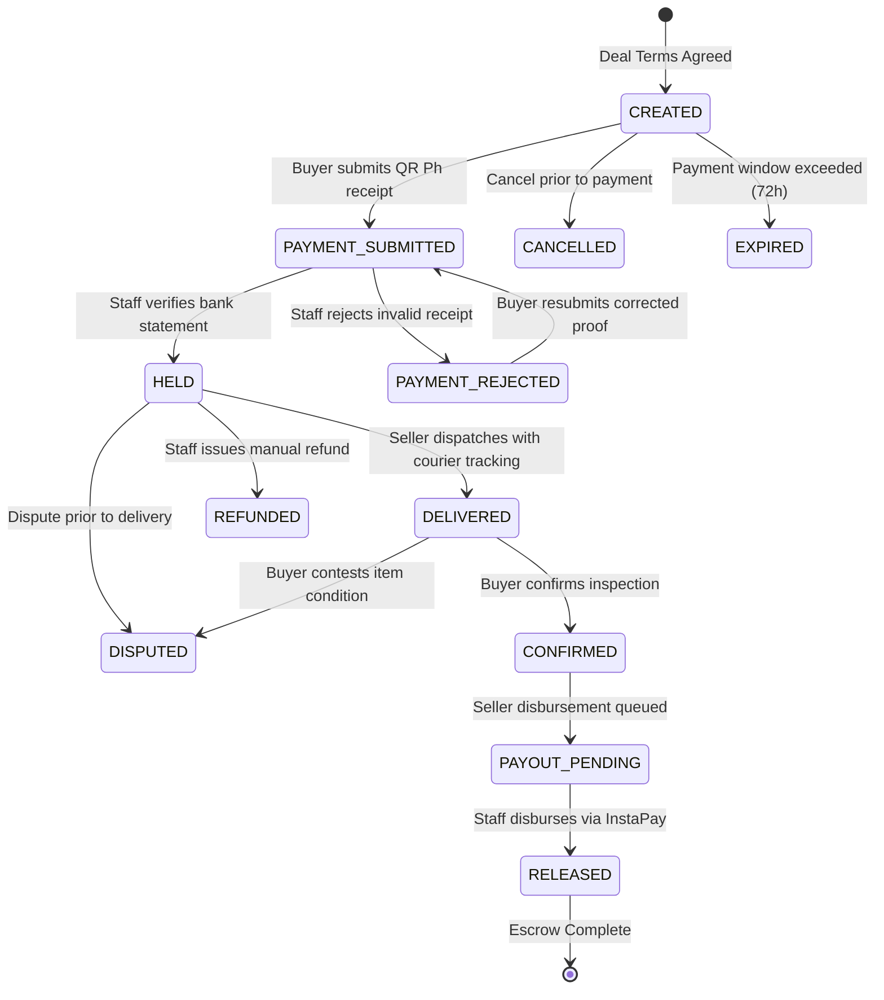

### Key Security & Financial Rules
1. **System Never Holds Money Directly**: The app stores status, references, and audit events. Money is transferred manually through Philippine banking/e-wallet channels (QR Ph / InstaPay).
2. **Minor Units (Integers)**: All money amounts are stored as integers in centavos (`17500000` = `₱175,000.00`). No floating-point math is used.
3. **Four-Eyes Rule**: For seller disbursements, the system prevents the same staff member who verified the incoming deposit from also authorizing the outbound payout.
4. **Anti-Fraud Duplicate Prevention**: Bank/InstaPay reference numbers have a unique database constraint (`UNIQUE (direction, reference_number)`) so receipts can never be reused across deals.
5. **Client Cannot Modify Status or Money**: All status changes go through the Postgres `transition_deal` `SECURITY DEFINER` function or Edge Functions.

---

## 🏛️ Legal & Regulatory Compliance Note (Philippines)

> [!IMPORTANT]
> **Regulatory Notice for Operating Escrow Services in the Philippines:**
>
> Holding customer funds in a company-owned bank account or e-wallet and releasing them upon counterparty fulfillment may classify the operator as an **Operator of Payment Systems (OPS)**, an **Electronic Money Issuer (EMI)**, or a **Trust/Escrow agent** under Bangko Sentral ng Pilipinas (BSP) circulars (Circular No. 1049, Circular No. 942, and the National Payment Systems Act - Republic Act No. 11127).
>
> **Checklist to Verify with Legal & Accounting Counsel prior to real-money launch:**
> - [ ] **BSP OPS Registration**: Determine whether SafeSwap must register as an Operator of Payment System under Circular No. 1049.
> - [ ] **Escrow Trust Agreement**: Establish an Escrow Agency Agreement with a BSP-licensed commercial bank (e.g. BDO, BPI, UnionBank) so funds sit in a dedicated Escrow Trust Account rather than general operating funds.
> - [ ] **AML/CFT Compliance (AMLC)**: Implement Anti-Money Laundering Council reporting procedures for transactions exceeding covered thresholds.
> - [ ] **KYC / Identity Verification**: Enforce Level 2 KYC (government ID verification) for single or cumulative transactions exceeding ₱50,000.00.
> - [ ] **Tax & BIR Withholding**: Clarify with an accountant whether the 3% escrow service fee requires VAT/income tax invoicing and withholding certificates (BIR Form 2307).
> - [ ] **Terms of Service**: Require all buyers and sellers to acknowledge:
>   - Manual verification SLA: Receipts verified within **2 hours** (8:00 AM – 8:00 PM PHT).
>   - Seller payout SLA: Disbursed via InstaPay within **24 hours** of buyer confirmation.
>   - Inspection window: Default **48 hours** for physical goods.

---

## 💻 Tech Stack & PWA Architecture

- **Frontend**: React 19, TypeScript, Vite, Tailwind CSS v4 design tokens, Radix UI accessible primitives.
- **PWA**: `vite-plugin-pwa` (Workbox) with offline precaching, standalone mobile display, and install prompts.
- **Backend & Database**: Supabase (Postgres with version-controlled migrations, Row Level Security, Storage, Realtime).
- **Offline / Local Sync**: TanStack Query persisted cache (24h localStorage) paired with Dexie.js (IndexedDB) for offline mutation queues with automatic background retry upon reconnection.
- **Testing Suite**: Vitest (58 tests covering state machine transitions, QR Ph provider, offline queue, and UI components), SQL RLS isolation tests, and Playwright screenshot automation harness.

---

## 🚀 Local Development Flow

### Setup & Installation
```bash
# Clone repository
git clone https://github.com/JRSstuff/middlemanservice.git
cd middlemanservice

# Install dependencies
npm install

# Configure environment variables
cp .env.example .env
```

### Run Dev Server
```bash
npm run dev
```
Open [http://localhost:5173](http://localhost:5173) in your browser.

> [!TIP]
> **Browser Cache Tip**: If you previously had the dev server open, perform a hard refresh (`Ctrl + Shift + R` on Windows/Linux or `Cmd + Shift + R` on macOS) to clear any cached service worker scripts and load fresh modules.

### Run Tests & Build Verification
```bash
# Run all 58 Vitest unit and integration tests
npm test

# Run production build and TypeScript check
npm run build
```

---

## 🛡️ Staff Console (`/staff`) & Verification Operations

Authorized staff members can access the Staff Console at `/staff` to review incoming payments, disburse seller funds, and handle disputes under an auditable workflow.

### How Staff Verify a Payment:
1. Navigate to `/staff` (accessible in dev mode or with staff persona).
2. On the **Incoming Payments** tab, select a pending transaction in `PAYMENT_SUBMITTED` status.
3. Review the buyer's uploaded proof receipt and stated reference number against SafeSwap's banking/e-wallet app statement.
4. Verify the exact amount received matches the required total centavos.
5. **If verified**: Click **Verify Deposit**. The deal moves to `HELD`, and the seller's dashboard updates to "Payment verified, funds held".
6. **If invalid or amount mismatch**: Click **Reject**, select or type the rejection reason. The status changes to `PAYMENT_REJECTED`, notifying the buyer to resubmit proof.

### How Staff Record a Payout:
1. Once a buyer confirms delivery inspection, the deal automatically moves to `PAYOUT_PENDING`.
2. Staff navigate to `/staff` and switch to the **Seller Payouts** tab.
3. Open the deal to reveal the seller's verified payout channel (GCash / Maya / Bank Name, Account Number, and Account Name).
4. Perform the manual transfer via InstaPay or QR Ph in the corporate banking app for the exact net amount (`amount_centavos - fee_centavos`).
5. In SafeSwap, enter the outbound InstaPay / bank reference number and upload the disbursement screenshot.
6. Click **Confirm Payout**.
   - *Note on Four-Eyes Rule*: The system enforces that the staff member who authorized the initial deposit verification cannot also execute the seller payout for that same deal. A second authorized staff member must record the payout.
7. The deal transitions to `RELEASED`. The seller receives the payout notification and timeline confirmation.
